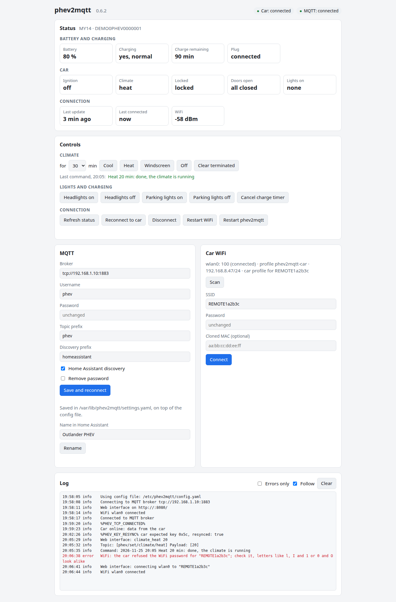
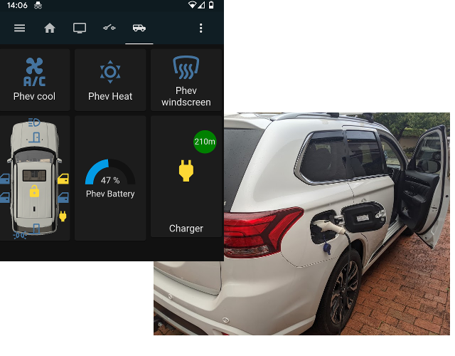

# phev2mqtt-nxt

Connects a Mitsubishi Outlander PHEV (or Eclipse Cross PHEV) to MQTT and Home Assistant,
over the car's own WiFi. A fork of [buxtronix/phev2mqtt](https://github.com/buxtronix/phev2mqtt).

<picture>
  <source media="(prefers-color-scheme: dark)" srcset="docs/web-interface-dark.png">
  
</picture>

## What it does

 * Shows the battery, charging, plug, doors, locks, lights and climate in Home Assistant
   (or anything else that speaks MQTT), and optionally the ignition, charge type, the
   car's own charge and climate timers and more (`extra_sensors`)
 * Pre-heats or cools the car, switches the lights and cancels the charge timer;
   optionally like the official app, keeping the car's own climate timers and reporting
   whether the climate really started (`climate_guard`)
 * Shows how far the car's clock is off, and sets it with a button (`extra_commands`)
 * Optionally recovers from the car rejecting the encryption without reconnecting
   (`key_resync`)
 * Tells you whether the car is connected, how strong its WiFi is, and when it last
   connected
 * Has a web interface for the status, the controls, the setup and the log; every button
   in it is also a Home Assistant button and an MQTT topic

Tested on an Outlander PHEV MY14 and MY18 and an Eclipse Cross (2022).

## Install

On a Raspberry Pi (any model) or another machine with Debian, Ubuntu or Raspberry Pi OS,
and a WiFi adapter within reach of the car:

```
version=0.7.0
deb=phev2mqtt_${version}_$(dpkg --print-architecture).deb
base=https://github.com/athomasse/phev2mqtt-nxt/releases/download/v$version
curl -fLO "$base/SHA256SUMS" -fLO "$base/$deb"
sha256sum -c --ignore-missing SHA256SUMS
sudo apt install "./$deb"
```

Releases after 0.5.0 also carry build provenance: `gh attestation verify "$deb" --repo
athomasse/phev2mqtt-nxt` checks that the package was built by this repository's release
workflow.

Turn on the web interface in `/etc/phev2mqtt/config.yaml` (`sudoedit` it):

```
web_listen: ":8080"
web_password: "something long"
```

Then start phev2mqtt and open `http://<machine>:8080` (any user name, that password):

```
sudo systemctl enable --now phev2mqtt
```

## Configure

In the web interface:

1. **Car WiFi**: the car's network (*REMOTExxxxxx*) and its password, which come with the
   car. This needs NetworkManager; without it, see the examples in
   `/usr/share/doc/phev2mqtt/examples/`. With NetworkManager, phev2mqtt also
   reconnects this network itself when the car is in range but NetworkManager
   stopped trying, as it does when the car drives off halfway through
   connecting.
2. **MQTT**: your broker, e.g. `tcp://192.168.1.10:1883`, with its user name and
   password.
3. Optionally the car's **name in Home Assistant**.

Then register with the car, once. Put the car into registration mode ("Setup Your
Vehicle" in the
[Mitsubishi instructions](https://www.mitsubishi-motors.com/en/products/outlander_phev/app/remote/)),
and within 5 minutes run:

```
sudo systemctl stop phev2mqtt
phev2mqtt client register
sudo systemctl start phev2mqtt
```

The car talks to one client at a time, so keep the Mitsubishi app disconnected. If the
WiFi refuses the password, check letters that look alike, like `l`, `I` and `1`.

For more sensors (ignition, charge type, the car's own timers
and more), set `extra_sensors: true`; they are best known for 2014-2017 cars.
`key_resync: true` recovers from the car rejecting the encryption without
reconnecting, and `climate_guard: true` starts the climate like the official app:
it keeps the car's own climate timers (2014-2017 cars), refuses while the car is
switched on or quick charging, and reports whether the climate really started.
`extra_commands: true` adds a Sync Car Clock button (Home Assistant and web
interface, or `phev/set/sync_clock`), which sets the car's clock to the gateway's.

All settings, with comments, are in `/etc/phev2mqtt/config.yaml`; the log is in
`journalctl -u phev2mqtt` and in the web interface.

## Home Assistant

The car shows up as a device by itself, through MQTT discovery, once phev2mqtt has
connected to it: search for "phev" in your entities.

The car's entities turn *unavailable* when the car is away (phev/available) or
phev2mqtt is down (phev/gateway/available), instead of keeping old values. The
*Connection*, *WiFi* and *Gateway* entities stay available while phev2mqtt runs,
so they show which of the two it is.



<details>
<summary>MQTT topics</summary>

Published, under the prefix `phev` (`mqtt_topic_prefix`):

| Topic | Value |
|---|---|
| phev/available | The car: *online* once connected and sending data; *offline* when its WiFi drops, 30 s after the connection is lost, or when it sent nothing for a whole `update_interval` |
| phev/gateway/available | phev2mqtt itself: *online*, or *offline* through the MQTT last will when it or its host goes down |
| phev/connection/last_connected, last_disconnected | When the car last connected and disconnected |
| phev/wifi/state, phev/wifi/signal | The car's WiFi: *connected* or *disconnected*, and the signal in dBm |
| phev/battery/level | Battery level, in percent |
| phev/charge/charging, plug, remaining | Charging *on*/*off*, plug *connected*/*unplugged*, minutes left |
| phev/climate/state | Climate *off*, *heat*, *cool*, *windscreen* or *terminated* |
| phev/climate/[cool, heat, windscreen] | *on* or *off* |
| phev/door/locked | *closed* when locked, *open* when not |
| phev/door/driver, front_passenger, rear_left, rear_right, bonnet, boot | *open* or *closed* |
| phev/lights/head, parking, hazard, interior | *on* or *off* |
| phev/vin, phev/registrations | The VIN, and the number of clients registered with the car |
| phev/power/switch | With `extra_sensors`: the ignition (power switch), *off*, *acc* or *on* |
| phev/charge/type | With `extra_sensors`: *none*, *normal*, *trickle* or *quick* |
| phev/charge/timer, timer_waiting, timer_failed, timer_schedule | With `extra_sensors`: the car's own charge timer *on*/*off*, waiting for it, a scheduled charge that failed, and its windows per day (JSON) |
| phev/climate/timer, timer_schedule | With `extra_sensors`: the car's own climate timer *on*/*off*, and its start time per day (JSON) |
| phev/battery/heater, too_cold | With `extra_sensors`: battery heater on (2014-2017 cars), and the car asking for the cable because the battery is too cold |
| phev/command/result | With `climate_guard` or `extra_commands`: the result of the last command, e.g. *2026-11-25 07:30 Heat 20 min: done, the climate is running* |
| phev/car/ev_ecu_error, screen_in_use, registration_standby, clock, clock_offset | With `extra_sensors`: EV-ECU communication error, the car's own screen in use, registration mode, the car's clock, and how many seconds it is ahead (+) of or behind (-) the gateway's clock |
| phev/register/[register] | Raw register values, in hex |

Commands:

| Topic | Payload |
|---|---|
| phev/set/climate/[cool, heat, windscreen] | Minutes: 10, 20 or 30 |
| phev/set/climate/mode | *off* |
| phev/set/headlights, parkinglights | *on* or *off* |
| phev/set/cancelchargetimer | Anything |
| phev/set/climate/state | *reset*: clears the *terminated* climate state |
| phev/set/refresh | Anything: asks the car for all its values now |
| phev/set/sync_clock | With `extra_commands`: anything, sets the car's clock to the gateway's |
| phev/connection | *on*, *off* or *restart* (reconnect to the car) |
| phev/restart | Anything: restarts phev2mqtt |
| phev/wifi/restart | Anything: runs `wifi_restart_command`, also without the car |
| phev/set/register/[register] | A raw register value, in hex |

</details>

For how the car's protocol works, see the [protocol documentation](protocol/README.md).

## Credits

phev2mqtt was written by **Ben Buxton** ([@buxtronix](https://github.com/buxtronix)),
who reverse engineered most of the protocol, and improved by the contributors to
[buxtronix/phev2mqtt](https://github.com/buxtronix/phev2mqtt/graphs/contributors):
[@zivillian](https://github.com/zivillian), who cracked the XOR security algorithm
([#16](https://github.com/buxtronix/phev2mqtt/issues/16)),
[@altserg](https://github.com/altserg), [@gmta](https://github.com/gmta),
[@nagisa](https://github.com/nagisa), [@martingjohn](https://github.com/martingjohn),
[@IceEyz](https://github.com/IceEyz), [@gnyman](https://github.com/gnyman) and
[@StMond](https://github.com/StMond). This fork also includes upstream pull requests by
[@Will-Honor](https://github.com/Will-Honor), [@lazytesting](https://github.com/lazytesting),
[@Grisu930](https://github.com/Grisu930) and [@altserg](https://github.com/altserg).
It was inspired by [phev-remote](https://github.com/phev-remote) by
[@papawattu](https://github.com/papawattu).

The extra sensors (`extra_sensors`), the key resync (`key_resync`), the climate
guard (`climate_guard`), the clock sync (`extra_commands`) and the Charger Connected and Interior Lights decoding come
from [@corautem](https://github.com/corautem)'s
[fork](https://github.com/corautem/phev2mqtt), which adapted them from
**PHEV Link** ([Anwo91/phev-remote-plus](https://github.com/Anwo91/phev-remote-plus)),
Copyright (C) 2026 Anwo91 and contributors: register layouts from its
`Registers.kt`, `RegisterDecoder.kt` and `ScheduleDecoder.kt`, command layouts from
`CarCommand.kt`, the key resync from `SecurityKey.kt` and `PhevSession.kt`, and test
values from `LogicTest.kt` and `ScheduleDecoderTest.kt`, translated from Kotlin to Go. All of it
is from PHEV Link's source as published on 14 October 2026, before version 1.0.92,
under the GNU General Public License version 3 or later; nothing from its later,
proprietary versions is used. The files concerned (`protocol/status.go`,
`protocol/status_test.go`, `protocol/message.go`, `protocol/raw.go`,
`client/client.go`, `cmd/climate_guard.go`, `cmd/commands.go`) say so in their comments.

This fork is maintained by Andre Thomasse ([@athomasse](https://github.com/athomasse)).
Issues and pull requests are welcome.

## Licence

GNU General Public License, version 3 or later; see [LICENSE](LICENSE).
Copyright 2021 Ben Buxton <bbuxton@gmail.com> and the contributors.
